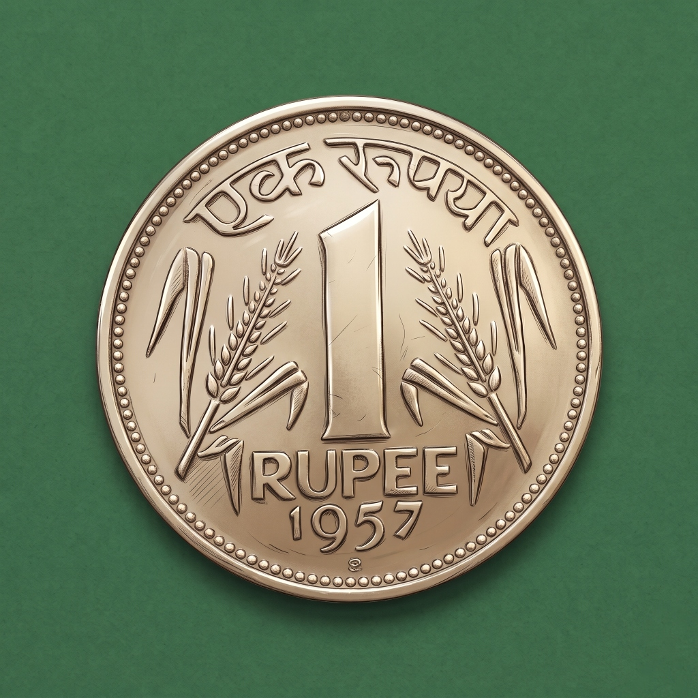

<p align="center">
  
</p>

<h1 align="center">1Pavala</h1>

<p align="center">
  <strong>Sovereign, Privacy-First Personal Finance & Expense Tracker</strong><br />
  <em>Every Paisa Matters. Zero Ads. Zero Cloud Scraping. 100% On-Device Sovereignty.</em>
</p>

<p align="center">
  
  
  
  
  
  
  
  
</p>

---

## 📖 About 1Pavala

In traditional Indian currency, a **"Pavala"** represents the historic quarter rupee (25 paise) — a symbol of grounded financial mindfulness where every single coin and paisa contributes to lasting prosperity.

**1Pavala** is built on an uncompromising principle: **your financial data belongs solely to you**. Unlike modern financial apps that demand bank login credentials, scrape confidential SMS inboxes, harvest telemetry, or push high-interest loan advertisements, 1Pavala operates entirely in an isolated, client-side sandbox.

No logins. No external servers. No telemetry. Just disciplined, frictionless money tracking with Apple-grade design craftsmanship.

---

## ✨ Key Features

### 🪙 Accurate Paisa Decimal Precision
- Track discretionary spending down to the exact paisa (e.g., `₹65.52`, `₹120.75`).
- Intelligent formatting keeps whole rupee values clean (`₹1,000`) while dynamically preserving decimals whenever fractional amounts exist.
- Normalized IEEE-754 summation ensures zero floating-point accumulation errors across budgets and ledgers.

### 📱 Native Android Homescreen Widgets & Floating Window
- **Quick Record Capsule Widget**: A sleek, pill-shaped stadium widget placed right on your Android homescreen featuring a `+` (Log Expense) button and a `Recent` transactions shortcut.
- **Floating Action Window**: Tapping the widget opens a lightweight, translucent floating window over your homescreen wallpaper — log an expense in 2 seconds without launching or switching into the full app.
- **Monthly Budget Dashboard Widget (4×2)**: Live glanceable spending monitor displaying month-to-date expenditure vs. monthly limit, 4-tier segmented category progress, Saver Milestone badge, and quick Budget Guard toggle.

### 🛡️ Smart Budget Pacing & Safety Runway
- **Monthly Spending Ceiling**: Set monthly budget caps with real-time burn-rate calculations.
- **3-Stage Visual Warning Alerts**:
  - 🟢 **Safe Zone (< 75%)**: Smooth green pacing indicator.
  - 🟡 **Caution (75% – 89%)**: Amber alert notifying that three-quarters of budget is consumed.
  - 🟠 **Warning (90% – 99%)**: High-alert warning prompting spending restraint.
  - 🔴 **Limit Exhausted (100%+)**: Urgent limit breach indicator. Alerts inform you without blocking record entry.
- **Safe Daily Spending Allowance**: Dynamic calculation showing exactly how much you can safely spend per day for the remainder of the month.

### 📊 Rich Visual Analytics & Insights
- **Interactive SVG Donut Chart**: Hover/tap category breakdowns with exact percentages and spend amounts.
- **Daily Spending Trajectory**: Interactive trend charts showing spending peaks and troughs across the month.
- **Multi-Period Navigation**: Balanced, edge-to-edge period switching across Daily, Weekly, Monthly, and Yearly intervals.
- **Payment Method Distribution**: Analyze cash flows across UPI, Credit Cards, Debit Cards, Cash, and Net Banking.
- **Month-over-Month Delta Analysis**: Track spending drift compared against previous billing cycles.

### 🎨 Custom Category Studio
- Comes pre-configured with essential categories: *Food & Dining, Groceries, Shopping, Transport, Bills & Utilities, Entertainment, Health, Education, Personal Care, and Investments*.
- Create, modify, and delete custom categories with dedicated color palettes and icon pickers.

### 💾 100% Data Sovereignty & Portability
- **Local IndexedDB Engine (`pavala_db_v1`)**: High-performance structured client-side database with automatic schema migrations and local storage fallback.
- **1-Click JSON Backup & Restore**: Export full snapshots of your transaction history and settings to safe cold storage anytime; restore with one click.
- **CSV Spreadsheet Export**: Export clean, structured tabular transaction data for external auditing in Microsoft Excel, Apple Numbers, or Google Sheets.

### 🍏 Apple HIG Design & Forest Emerald Palette
- Inspired by Apple Human Interface Guidelines: continuous squircle curvature, liquid glass functional layers, and high-legibility typography (*Plus Jakarta Sans*).
- Bespoke **Sovereign Forest Green** (`#3E6948`) and **Antique Gold Coin** medallion design.
- Complete Light Mode and Dark Mode support with instantaneous, flicker-free theme switching.

---

## 📱 Supported Platforms

| Platform | Deployment Type | Capabilities |
| :--- | :--- | :--- |
| **Web Browser** | SPA (Desktop / Laptop / Tablet) | Full analytics, keyboard shortcuts, CSV/JSON backups |
| **Progressive Web App (PWA)** | Installable Web App (iOS & Android) | Offline service worker caching, standalone app window |
| **Android APK** | Native Capacitor 8 Build | Native homescreen widgets, translucent floating window |

---

## 🏗️ Architecture & Data Flow

```text
┌──────────────────────────────────────────────────────────────────┐
│                   User Touchpoints & Interfaces                  │
│                                                                  │
│  [ Web & Tablet SPA ]    [ iOS / Android PWA ]   [ Android App ] │
│                                                        │         │
│                                            ┌───────────┴──────┐  │
│                                            │ Homescreen Widgets│  │
│                                            │  - Quick Capsule │  │
│                                            │  - Budget Dash   │  │
│                                            └───────────┬──────┘  │
│                                                        │         │
│                                            ┌───────────▼──────┐  │
│                                            │ Floating Activity│  │
│                                            └───────────┬──────┘  │
└────────────────────────────────┬───────────────────────┼─────────┘
                                 │                       │
                                 ▼                       ▼
┌──────────────────────────────────────────────────────────────────┐
│                  Application Context & Store                     │
│               (State, Calculations & Formatting)                │
└────────────────────────────────┬─────────────────────────────────┘
                                 │
                                 ▼
┌──────────────────────────────────────────────────────────────────┐
│             Local Persistence Engine (100% On-Device)            │
│                                                                  │
│    IndexedDB (`pavala_db_v1`)  ◄──►  Web Storage Fallback        │
│                                                                  │
│       [ JSON Backup Export ]        [ CSV Spreadsheet Export ]   │
└──────────────────────────────────────────────────────────────────┘
```

---

## 🚀 Quick Start & Local Development

### Prerequisites
- **Node.js**: `v20.x` or `v22.x` (LTS recommended)
- **npm**: `v10.x` or higher
- *(Optional for Android builds)*: **Android Studio** (Koala / Ladybug or newer) with Java 21 JDK and Android SDK 35

### 1. Clone & Install
```bash
git clone https://github.com/jashwanth-04/1Pavala.git
cd 1Pavala

# Install dependencies cleanly
npm install
```

### 2. Run Web Development Server
```bash
npm run dev
```
Open **`http://localhost:3000`** in your browser.

### 3. Build Web & PWA Bundle
```bash
npm run build
```
This bundles the optimized web application into the `dist/` folder and registers the PWA service worker with Workbox precache.

---

## 🤖 Building the Android APK

### Method A: Automated GitHub Actions CI/CD (Recommended)
You do not need to install Android Studio locally to generate the APK. A high-speed GitHub Actions workflow is built into this repository:

1. Navigate to the **Actions** tab in this GitHub repository.
2. Under **Workflows** on the left, click **"Build 1Pavala Android APK"**.
3. Click the **"Run workflow"** dropdown button on the right.
4. Select the target branch (e.g. `1Pavala-apkv1` or `main`) and click **"Run workflow"**.
5. Once the job completes (~1–2 minutes), download the ready-to-install **`1Pavala.apk`** artifact directly from the workflow summary page!

### Method B: Local Native Android Build
```bash
# 1. Build the web distribution
npm run build

# 2. Sync web assets and plugins to the native Android directory
npx cap sync android

# 3. Build debug APK using Gradle wrapper
cd android
./gradlew assembleDebug      # On Linux/macOS
gradlew.bat assembleDebug    # On Windows

# The output APK will be located at:
# android/app/build/outputs/apk/debug/app-debug.apk
```

---

## 🔒 Privacy & Security Guarantee

1Pavala is deliberately engineered to have **zero external server dependencies**:
- **Zero Third-Party Trackers**: No Google Analytics, no Facebook SDK, no Mixpanel, no Sentry.
- **Zero Financial Scrapers**: No Plaid, Yodlee, or account aggregation APIs that require bank credentials.
- **Zero Network Ingestion**: The app never sends your expense names, amounts, categories, or notes to any cloud endpoint.
- **Full Offline Reliability**: Fully operable with airplane mode enabled.

---

## 📂 Project Structure

```text
1Pavala/
├── .github/workflows/          # GitHub Actions CI/CD pipeline (build-apk.yml)
├── android/                    # Capacitor Android native project
│   ├── app/src/main/
│   │   ├── java/com/onepavala/app/
│   │   │   ├── MainActivity.java             # Main Capacitor Bridge Activity
│   │   │   ├── FloatingActionActivity.java   # Translucent floating expense window
│   │   │   ├── QuickRecordWidgetProvider.java# Quick Record homescreen capsule widget
│   │   │   └── MonthlyBudgetWidgetProvider.java # Monthly budget dashboard widget
│   │   ├── res/layout/                       # Native widget XML layouts
│   │   ├── res/drawable/                     # Widget backgrounds & drawables
│   │   └── res/mipmap-*/                     # Adaptive emerald coin launcher icons
├── public/                     # Static PWA assets, icons & splash branding
│   ├── logo.png                # Emerald Pavala Coin medallion (512x512)
│   ├── logo.svg                # Vector master logo
│   └── manifest.json           # PWA web manifest
├── src/
│   ├── components/
│   │   ├── budget/             # Monthly budget ceiling & alert views
│   │   ├── charts/             # SVG Donut, Progress bars & Trend charts
│   │   ├── common/             # Header, Navigation, Logo, Toast, Modal
│   │   ├── dashboard/          # Main overview dashboard
│   │   ├── expenses/           # Add/Edit expense modal & transaction ledger
│   │   ├── insights/           # Multi-period analytics & spending trajectory
│   │   ├── settings/           # Custom categories, backup/restore & preferences
│   │   └── widgets/            # Web floating window router & widget views
│   ├── constants/              # Predefined expense categories & color mappings
│   ├── context/                # Global reactive state (AppContext)
│   ├── services/               # IndexedDB (`indexedDB.ts`) & LocalStorage fallback
│   ├── utils/                  # Currency and accurate paisa formatters
│   ├── App.tsx                 # Root application router & layout orchestrator
│   └── main.tsx                # Application bootstrap
├── capacitor.config.ts         # Capacitor native configuration
├── tailwind.config.js          # Tailwind styling tokens & theme colors
├── vite.config.ts              # Vite 6 + VitePWA build configuration
└── package.json                # Project dependencies & build scripts
```

---

## 📄 License

This project is open-source under the **[MIT License](LICENSE)**. Feel free to use, inspect, fork, and adapt it for your personal financial sovereignty.
